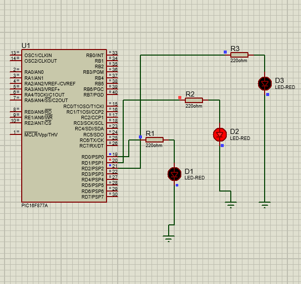

# 01. Watchdog Timer

## 1. Project Title
**PIC16F877A Autonomous Fault Recovery Using Hardware Watchdog Timer (WDT)**

## 2. Project Overview
Intentionally trap the firmware in an infinite loop without clearing the watchdog. Demonstrate automatic PIC resetting and restarting an LED sequence.

## 3. Objective
- Understand the hardware architecture of the PIC16F877A on-chip Watchdog Timer.
- Configure the WDT prescaler using the `OPTION_REG` register.
- Implement software servicing of the watchdog using the `CLRWDT()` macro during healthy execution.
- Induce an intentional firmware lockup and observe autonomous hardware reset recovery.

## 4. Components Required
- **Microcontroller:** Microchip PIC16F877A (40-pin DIP)
- **Oscillator:** 20 MHz Quartz Crystal with dual 22 pF ceramic load capacitors
- **Resistors:** 3x 220 Ohm, 0.25 W (current limiting)
- **LEDs:** 3x 5 mm Red LEDs (Normal Blink indicator, Fault indicator, Auxiliary)
- **Power Supply:** +5.0 V DC regulated rail & common ground

## 5. Software and Tools
- **IDE:** MPLAB X IDE v6.xx
- **Compiler:** Microchip XC8 Compiler v2.xx (C99 mode)
- **Simulation Suite:** Labcenter Electronics Proteus 8 Professional (v8.13)
- **Target Device:** PIC16F877A

## 6. Circuit Connections
| Pin # | PIC16F877A Pin | Component Connection | Purpose |
|---|---|---|---|
| Pin 19 | `RD0/PSP0` | 220 Ohm -> Anode of D1 (Red LED) | Normal operation blink indicator |
| Pin 20 | `RD1/PSP1` | 220 Ohm -> Anode of D2 (Red LED) | Fault phase indicator (illuminates before lockup) |
| Pin 21 | `RD2/PSP2` | 220 Ohm -> Anode of D3 (Red LED) | Auxiliary schematic output |
| Pin 13, 14 | `OSC1, OSC2` | 20 MHz Quartz Crystal | High-speed system clock (HS mode) |
| Pin 1 | `MCLR/Vpp` | +5.0 V DC | Master reset input |

## 7. Working Principle
The Watchdog Timer is driven by an internal, independent RC oscillator nominal at ~18 ms baseline timeout. Through `OPTION_REG`, the prescaler is assigned to the WDT at a 1:128 ratio, establishing an effective timeout period:
$$T_{WDT} \approx 18\text{ ms} \times 128 \approx 2.304\text{ seconds}$$
During normal execution (Stage 1), the firmware blinks LED D1 across 7 cycles (300 ms ON / 300 ms OFF) while issuing `CLRWDT()` each cycle. In Stage 2, LED D2 lights solid and firmware enters `while(1) {}` without calling `CLRWDT()`. After 2.3 seconds, the timer overflows and forces an internal hardware reset, re-executing code from vector `0x0000`.

## 8. Code Explanation
Source file: [`MPLAB/project_01.X/WATCHDOG_TIMER.c`](MPLAB/project_01.X/WATCHDOG_TIMER.c)
- **Configuration Bits:** `#pragma config WDTE = ON` activates the hardware watchdog timer at boot.
- **Prescaler Assignment:**
  - `OPTION_REGbits.PSA = 1`: Assigns prescaler to WDT.
  - `OPTION_REGbits.PS2 = 1; OPTION_REGbits.PS1 = 1; OPTION_REGbits.PS0 = 1;`: Sets prescaler to 1:128.
- **Serviced Execution:** The `for(int i = 0; i < 7; i++)` loop toggles RD0 with 300 ms delays and issues `CLRWDT()` to maintain watchdog health.
- **Fault Emulation:** Sets RD0=0, RD1=1, and traps execution in an empty `while(1) {}`.

## 9. How to Run the Proteus Simulation
1. Launch Proteus Design Suite.
2. Open [`Proteus/project_01_watchdog_Timer [20261030, 14-17-15].pdsprj`](Proteus/).
3. Double-click the PIC16F877A microcontroller (U1) to open device properties.
4. Verify that the **Program File** path points to [`MPLAB/project_01.X/dist/default/production/PIC16F877A_PROJECTS.X.production.hex`](MPLAB/project_01.X/dist/default/production/PIC16F877A_PROJECTS.X.production.hex).
5. Set Clock Frequency to `20MHz`.
6. Click the **Play** button in the lower-left control bar.

## 10. Expected Output
- D1 flashes 7 times sequentially (~4.2 seconds).
- D1 turns OFF and D2 turns ON.
- D2 remains lit for approximately 2.3 seconds with no CPU activity.
- The microcontroller automatically resets, D2 turns OFF, and D1 immediately begins flashing again.

## 11. Actual Testing Status
- **Firmware Compilation:** Verified; production HEX binary present in `dist/default/production/`.
- **Proteus Circuit:** Verified; design schematic matches hardware specifications.
- **Simulation Verification:** Confirmed with actual captured simulation screenshot.

## 12. Screenshots

*Figure 1: Proteus simulation schematic of the PIC16F877A Watchdog Timer circuit.*

## 13. Learning Outcomes
- Configuring embedded watchdog supervisory systems for mission-critical reliability.
- Calculating prescaled watchdog timeout durations.
- Distinguishing between normal execution loops and fault lockups.
- Hands-on register manipulation of `OPTION_REG`.
