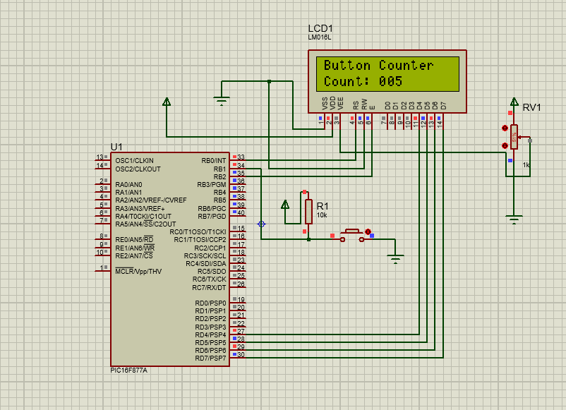

# 02. Button Debouncing with LCD

## 1. Project Title
**Active-Low Pushbutton Software Debouncing with 16x2 Alphanumeric LCD Event Counter**

## 2. Project Overview
Connect a push button and display the count on an LCD. Demonstrate switch bouncing and software debouncing.

## 3. Objective
- Understand mechanical switch contact bounce characteristics.
- Implement a two-stage software debouncing algorithm with release verification.
- Interface an HD44780-compatible 16x2 character LCD in 4-bit nibble mode.
- Format and display real-time event counts without false trigger artifacts.

## 4. Components Required
- **Microcontroller:** PIC16F877A
- **Display:** LM016L 16x2 Character LCD (HD44780 controller)
- **Input Switch:** Tactile Momentary Pushbutton (SPST-NO)
- **Resistors:** 1x 10 kOhm, 0.25 W (pull-up resistor)
- **Potentiometer:** 1x 1 kOhm (LCD contrast adjustment)
- **Power Supply:** +5.0 V DC & Ground

## 5. Software and Tools
- **IDE:** MPLAB X IDE
- **Compiler:** Microchip XC8 Compiler
- **Simulation Suite:** Proteus 8 Professional
- **Target Device:** PIC16F877A

## 6. Circuit Connections
| Pin # | PIC16F877A Pin | Component Connection | Purpose |
|---|---|---|---|
| Pin 34 | `RB1` | Pushbutton & 10 kOhm pull-up to +5V | Active-low button input |
| Pin 33 | `RB0/INT` | LCD Pin 4 (`RS`) | Register Select (0=Cmd, 1=Data) |
| Pin 35 | `RB2` | LCD Pin 6 (`EN`) | LCD Enable strobe line |
| Pins 27–30 | `RD4–RD7` | LCD Pins 11–14 (`D4–D7`) | 4-bit multiplexed data bus |
| — | LCD Pin 3 (`VEE`) | RV1 Wiper | Contrast voltage control |

## 7. Working Principle
Mechanical switches oscillate between conductive and open states for 5 to 20 ms upon contact impact. If connected directly to an interrupt or polled input without filtering, a single actuation registers multiple false increments.
The software debouncing algorithm eliminates contact chatter:
1. Detect initial logic LOW on `RB1`.
2. Delay 20 ms (`__delay_ms(20)`) to let mechanical chatter settle.
3. Re-read `RB1`. If still LOW, increment the event counter and refresh the display.
4. Execute `while(BUTTON == 0);` to wait for physical release, followed by an additional 20 ms delay to filter break chatter.

## 8. Code Explanation
Source file: [`MPLAB/PROJECT_02 DEBOUNCING_with_lcd.X/project2.c`](MPLAB/PROJECT_02 DEBOUNCING_with_lcd.X/project2.c)
- **Pin Configuration:** `ADCON1 = 0x06` configures all pins as digital I/O. `TRISB = 0b00000010` configures RB1 as input. `TRISD = 0x0F` configures RD4–RD7 as LCD outputs.
- **4-Bit LCD Driver:** `LCD_Command()` and `LCD_Char()` split 8-bit bytes into high and low nibbles, masking `PORTD = (PORTD & 0x0F) | (data & 0xF0)` with strobe pulsing.
- **Display Formatting:** `Display_Count()` extracts hundreds, tens, and units digits via integer arithmetic (`count / 100`, `(count / 10) % 10`, `count % 10`) and prints `"Count: 005"`.

## 9. How to Run the Proteus Simulation
1. Open [`Proteus/PROJECT_2 Button_Debouncing_with_LCD [20261113, 21-30-14].pdsprj`](Proteus/).
2. Verify that U1 firmware points to [`MPLAB/PROJECT_02 DEBOUNCING_with_lcd.X/dist/default/production/PROJECT_2_DEBOUNCING_with_lcd.X.production.hex`](MPLAB/PROJECT_02 DEBOUNCING_with_lcd.X/dist/default/production/PROJECT_2_DEBOUNCING_with_lcd.X.production.hex).
3. Start simulation.
4. Click the pushbutton connected to RB1.

## 10. Expected Output
- LCD Line 1 displays: `Button Counter`.
- LCD Line 2 displays: `Count: 000`.
- Each button press cleanly increments the count by exactly 1 (`Count: 001`, `Count: 002`, etc.) with zero spurious counts.

## 11. Actual Testing Status
- **Firmware Compilation:** Verified; production HEX binary present.
- **Proteus Circuit:** Verified; design schematic matches hardware specifications.
- **Simulation Verification:** Confirmed with actual captured simulation screenshot showing `Count: 005`.

## 12. Screenshots

*Figure 2: Proteus simulation showing active-low debounced button incrementing LCD counter to 005.*

## 13. Learning Outcomes
- Understanding mechanical contact bounce physics.
- Implementing robust, non-glitching software debouncing state machines.
- Interfacing character LCDs using 4-bit nibble protocols.
