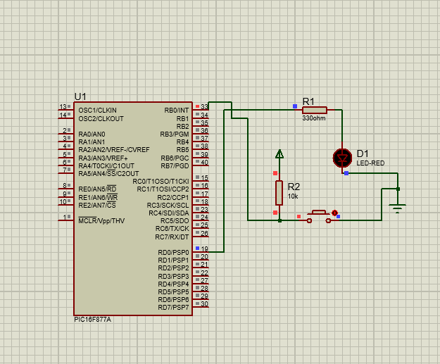

# 03. External Interrupt on RB0/INT

## 1. Project Title
**Asynchronous Event Detection Using PIC16F877A Hardware External Interrupt (RB0/INT)**

## 2. Project Overview
Use RB0/INT to detect a button press while the main program is busy. Record the interrupt event for the main program.

## 3. Objective
- Configure the PIC16F877A hardware External Interrupt module on pin `RB0/INT`.
- Set up the interrupt edge trigger polarity using `OPTION_REGbits.INTEDG`.
- Implement an Interrupt Service Routine (ISR) with asynchronous flag signaling.
- Decouple time-critical external inputs from blocking foreground tasks.

## 4. Components Required
- **Microcontroller:** PIC16F877A
- **Input Switch:** Momentary Tactile Pushbutton (SPST-NO)
- **Indicator:** 5 mm Red LED
- **Resistors:** 1x 10 kOhm (pull-up), 1x 330 Ohm (LED current limiting)
- **Power Supply:** +5.0 V DC & Ground

## 5. Software and Tools
- **IDE:** MPLAB X IDE
- **Compiler:** Microchip XC8 Compiler
- **Simulation Suite:** Proteus 8 Professional
- **Target Device:** PIC16F877A

## 6. Circuit Connections
| Pin # | PIC16F877A Pin | Component Connection | Purpose |
|---|---|---|---|
| Pin 33 | `RB0/INT` | Pushbutton & 10 kOhm pull-up to +5V | Hardware External Interrupt pin |
| Pin 19 | `RD0/PSP0` | 330 Ohm -> Anode of D1 (Red LED) | Visual status indicator |
| Pins 11, 32 | `VDD` | +5.0 V | Microcontroller power |
| Pins 12, 31 | `VSS` | GND (0 V) | Ground |

## 7. Working Principle
In a standard polling architecture, if the CPU is in the middle of a blocking delay (`__delay_ms(300)`), any momentary button press is completely missed.
Hardware interrupts resolve this:
- An active-low button press produces a falling edge on `RB0/INT`.
- The CPU immediately suspends execution, pushes the Program Counter onto the stack, and branches to address `0x0004` (`ISR`).
- The ISR verifies `INTCONbits.INTF`, records the event by setting volatile variable `button_event = 1`, clears `INTF = 0`, and returns.
- The main loop detects `button_event == 1` and executes an extended 1000 ms LED pulse before resuming normal blinking.

## 8. Code Explanation
Source file: [`MPLAB/Project_03_ External_Interrupt.X/project_3.c`](MPLAB/Project_03_ External_Interrupt.X/project_3.c)
- **Interrupt Configuration:**
  - `OPTION_REGbits.INTEDG = 0`: Sets falling-edge trigger sensitivity on RB0.
  - `INTCONbits.INTE = 1`: Enables the RB0 external interrupt.
  - `INTCONbits.GIE = 1`: Enables global interrupt dispatching.
- **Interrupt Service Routine:**
  ```c
  void __interrupt() ISR(void) {
      if (INTCONbits.INTF == 1) {
          button_event = 1;
          INTCONbits.INTF = 0;
      }
  }
  ```
- **Foreground Loop:** Blinks LED RD0 at 300 ms intervals. When `button_event` is flagged, it holds the LED ON for 1000 ms, resets the flag, and resumes normal blinking.

## 9. How to Run the Proteus Simulation
1. Open [`Proteus/Project_3 External_Interrupt [20261109, 11-00-55].pdsprj`](Proteus/).
2. Verify U1 hex path points to [`MPLAB/Project_03_ External_Interrupt.X/dist/default/production/Project_03__External_Interrupt.X.production.hex`](MPLAB/Project_03_ External_Interrupt.X/dist/default/production/Project_03__External_Interrupt.X.production.hex).
3. Start simulation.
4. Click the pushbutton at any time during the LED blink cycle.

## 10. Expected Output
- Normal state: Red LED blinks continuously at 300 ms ON / 300 ms OFF.
- Interrupt trigger: Clicking the button instantly flags an interrupt. The LED immediately remains lit for 1000 ms, then smoothly returns to 300 ms blinking.

## 11. Actual Testing Status
- **Firmware Compilation:** Verified; production HEX binary present.
- **Proteus Circuit:** Verified; design schematic matches hardware specifications.
- **Simulation Verification:** Confirmed with actual captured simulation screenshot.

## 12. Screenshots

*Figure 3: Proteus schematic showing pushbutton wired to RB0/INT and LED on RD0.*

## 13. Learning Outcomes
- Understanding hardware interrupt priority and latency.
- Safe communication between ISR and foreground code using `volatile` flags.
- Distinguishing polled I/O vs. interrupt-driven embedded architectures.
