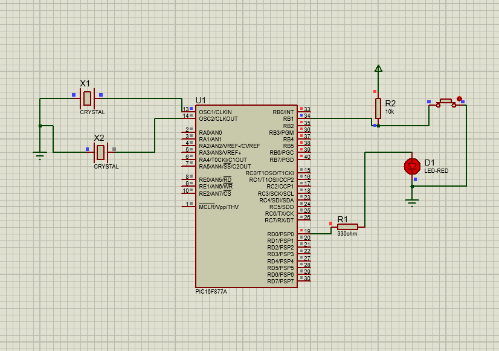

# 04. Timer0 LED Scheduling

## 1. Project Title
**Non-Blocking Hardware Timer0 LED Scheduling and Concurrent Input Polling**

## 2. Project Overview
Compare delay-based LED blinking with Timer0-based scheduling. Demonstrate simultaneous button handling and LED blinking.

## 3. Objective
- Understand the hardware architecture of 8-bit Timer0 on the PIC16F877A.
- Calculate prescaler and preload values for deterministic periodic timing.
- Implement a non-blocking cooperative execution architecture using timer overflow interrupts.
- Demonstrate concurrent background LED scheduling alongside responsive foreground button polling.

## 4. Components Required
- **Microcontroller:** PIC16F877A
- **Clock:** 20 MHz Quartz Crystal with dual ceramic capacitors
- **Inputs:** Tactile Pushbutton with 10 kOhm pull-up resistor
- **Outputs:** Red 5 mm LED with 330 Ohm current-limiting resistor
- **Power Supply:** +5.0 V DC & Ground

## 5. Software and Tools
- **IDE:** MPLAB X IDE
- **Compiler:** Microchip XC8 Compiler
- **Simulation Suite:** Proteus 8 Professional
- **Target Device:** PIC16F877A

## 6. Circuit Connections
| Pin # | PIC16F877A Pin | Component Connection | Purpose |
|---|---|---|---|
| Pin 34 | `RB1` | Pushbutton & 10 kOhm pull-up | Foreground user input |
| Pin 19 | `RD0/PSP0` | 330 Ohm -> Anode of D1 (Red LED) | Scheduled blinking LED output |
| Pins 13, 14 | `OSC1, OSC2` | 20 MHz Crystal | Master clock reference |

## 7. Working Principle
Delay functions (`__delay_ms()`) burn CPU instruction cycles in idle spin-loops, preventing concurrent input handling.
Timer0 scheduling replaces software delays with autonomous hardware counting:
- Clock frequency $F_{OSC} = 20\text{ MHz} \implies F_{CY} = 5\text{ MHz}$ ($T_{CY} = 200\text{ ns}$).
- Prescaler set to `1:256` gives tick duration = $200\text{ ns} \times 256 = 51.2\ \mu\text{s}$.
- Reloading `TMR0 = 100` requires $256 - 100 = 156$ counts to overflow:
$$T_{overflow} = 156 \times 51.2\ \mu\text{s} \approx 7.987\text{ ms} \approx 8\text{ ms}$$
- Accumulating 10 overflows produces an ~80 ms timing tick that toggles the LED without blocking the CPU. The CPU remains free to poll button `RB1` with instant responsiveness.

## 8. Code Explanation
Source file: [`MPLAB/project_4 blink_without_frezz.X/project_4.c`](MPLAB/project_4 blink_without_frezz.X/project_4.c)
- **`OPTION_REG = 0b00000111`:** Selects internal instruction clock (`T0CS = 0`), assigns prescaler to Timer0 (`PSA = 0`), and sets prescaler to 1:256 (`PS = 111`).
- **Timer0 ISR:**
  ```c
  void __interrupt() ISR(void) {
      if (INTCONbits.TMR0IF) {
          TMR0 = 100;
          INTCONbits.TMR0IF = 0;
          timer_count++;
          if (timer_count >= 10) {
              timer_count = 0;
              blink_event = 1;
          }
      }
  }
  ```
- **Main Scheduling Loop:** Checks `if (blink_event)` to toggle RD0, while concurrently checking `if (PORTBbits.RB1 == 0)` to handle button presses without delay-induced latency.

## 9. How to Run the Proteus Simulation
1. Open [`Proteus/Project_4_Blink_without_freezing_program [20261031, 23-02-58].pdsprj`](Proteus/).
2. Verify U1 hex path points to [`MPLAB/project_4 blink_without_frezz.X/dist/default/production/project_4_blink_without_frezz.X.production.hex`](MPLAB/project_4 blink_without_frezz.X/dist/default/production/project_4_blink_without_frezz.X.production.hex).
3. Start simulation.
4. Observe the continuous blinking of LED D1 while pressing button RB1.

## 10. Expected Output
- Red LED D1 toggles at deterministic ~80 ms intervals.
- Pressing button RB1 immediately turns the LED ON and holds it until release, demonstrating simultaneous input response without freezing the blink scheduler.

## 11. Actual Testing Status
- **Firmware Compilation:** Verified; production HEX binary present.
- **Proteus Circuit:** Verified; design schematic matches hardware specifications.
- **Simulation Verification:** Confirmed with actual captured simulation screenshot.

## 12. Screenshots

*Figure 4: Proteus schematic showing Timer0 scheduling circuit with crystal oscillator, button, and LED.*

## 13. Learning Outcomes
- Hardware timer calculations and overflow interrupt servicing.
- Designing non-blocking embedded software architectures.
- Eliminating delay bottlenecks in real-time embedded systems.
