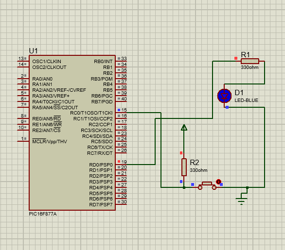

# 05. Floating Input Demonstration

## 1. Project Title
**Analysis and Mitigation of CMOS Floating Digital Inputs on PIC16F877A GPIO**

## 2. Project Overview
Demonstrate random readings from an unconnected digital input. Add a pull-up or pull-down resistor to obtain stable readings.

## 3. Objective
- Understand the physical characteristics of high-impedance CMOS digital input gates.
- Observe the susceptibility of unconnected ("floating") pins to electrostatic and electromagnetic noise.
- Implement hardware pull-up/pull-down resistor biasing to guarantee deterministic logic states.
- Interface a digital input pin (`RC0`) to an output indicator LED (`RD0`).

## 4. Components Required
- **Microcontroller:** PIC16F877A
- **Indicator:** 5 mm Blue LED
- **Resistors:** 1x 330 Ohm (LED current limiting), 1x 330 Ohm (input pull-up / bias resistor)
- **Input Switch:** SPST Pushbutton
- **Power Supply:** +5.0 V DC & Ground

## 5. Software and Tools
- **IDE:** MPLAB X IDE
- **Compiler:** Microchip XC8 Compiler
- **Simulation Suite:** Proteus 8 Professional
- **Target Device:** PIC16F877A

## 6. Circuit Connections
| Pin # | PIC16F877A Pin | Component Connection | Purpose |
|---|---|---|---|
| Pin 15 | `RC0/T1OSO/T1CKI` | Pushbutton & 330 Ohm pull-up to +5V | Digital input under evaluation |
| Pin 19 | `RD0/PSP0` | 330 Ohm -> Anode of D1 (Blue LED) | Logic state indicator |
| Pins 11, 32 | `VDD` | +5.0 V | Power supply |
| Pins 12, 31 | `VSS` | GND (0 V) | Ground |

## 7. Working Principle
CMOS input stages consist of complementary MOSFET gates with input impedance exceeding $10^{12}\ \Omega$. When no voltage is actively applied, the gate capacitance retains stray charges, and the pin floats near the switching threshold ($V_{DD}/2 \approx 2.5\text{ V}$).
- **Floating Condition:** Nearby AC fields, electrical noise, or physical contact cause the pin voltage to bounce randomly between logic 0 and 1, producing erratic LED output and high shoot-through current.
- **Biased Condition:** Adding a pull-up resistor (e.g., 330 Ohm or 10 kOhm) ties the node solidly to $V_{DD}$ ($5.0\text{ V}$) when the switch is open, ensuring a clean, deterministic logic HIGH. When pressed, the switch pulls the pin directly to $0.0\text{ V}$ (logic LOW).

## 8. Code Explanation
Source file: [`MPLAB/project_05_Floating_input.X/project_5.c`](MPLAB/project_05_Floating_input.X/project_5.c)
- **Port Direction:** `TRISCbits.TRISC0 = 1` sets RC0 as input; `TRISDbits.TRISD0 = 0` sets RD0 as output.
- **Logic Evaluation:**
  ```c
  if (PORTCbits.RC0 == 0) {
      PORTDbits.RD0 = 1;  // Button pressed: LED ON
  } else {
      PORTDbits.RD0 = 0;  // Button released: LED OFF
  }
  ```

## 9. How to Run the Proteus Simulation
1. Open [`Proteus/Project_5_Floating_Input [20261101, 10-33-32].pdsprj`](Proteus/).
2. Verify U1 hex path points to [`MPLAB/project_05_Floating_input.X/dist/default/production/project_05_Floating_input.X.production.hex`](MPLAB/project_05_Floating_input.X/dist/default/production/project_05_Floating_input.X.production.hex).
3. Start simulation.
4. Toggle the switch to observe deterministic switching under pull-up biasing.

## 10. Expected Output
- Switch open: Pin RC0 pulled HIGH; Blue LED RD0 is OFF.
- Switch closed: Pin RC0 grounded LOW; Blue LED RD0 illuminates solidly.
- Zero spurious flickering or undefined logic transitions.

## 11. Actual Testing Status
- **Firmware Compilation:** Verified; production HEX binary present.
- **Proteus Circuit:** Verified; design schematic matches hardware specifications.
- **Simulation Verification:** Confirmed with actual captured simulation screenshot.

## 12. Screenshots

*Figure 5: Proteus schematic demonstrating digital input conditioning with pull-up biasing.*

## 13. Learning Outcomes
- Fundamentals of CMOS digital input impedance and gate behavior.
- Designing noise-immune digital circuits using pull-up and pull-down networks.
- Practical hardware troubleshooting of erratic microcontroller inputs.
