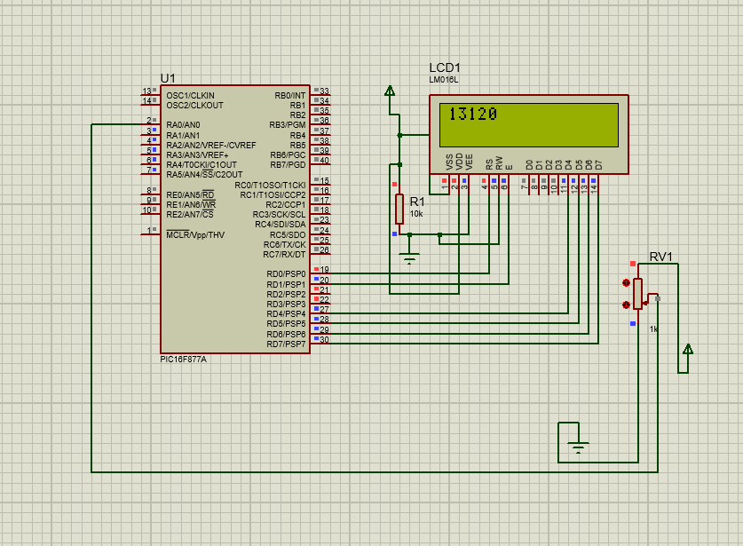

# 06. ADC Potentiometer

## 1. Project Title
**10-Bit Analog-to-Digital Conversion (ADC) with 16x2 LCD Visualization on PIC16F877A**

## 2. Project Overview
Connect a potentiometer to an analog input and display the 10-bit ADC reading from 0 to 1023.

## 3. Objective
- Configure the PIC16F877A on-chip 10-bit Successive Approximation Register (SAR) ADC module.
- Select analog channel `AN0/RA0` and configure voltage references.
- Implement sampling acquisition delays and initiate conversions via `ADCON0bits.GO`.
- Render raw digital conversion codes (0 to 1023) on an alphanumeric LCD.

## 4. Components Required
- **Microcontroller:** PIC16F877A
- **Analog Input:** 1 kOhm Linear Potentiometer (RV1)
- **Display:** LM016L 16x2 Alphanumeric LCD
- **Resistor:** 1x 10 kOhm (contrast bias)
- **Power Supply:** +5.0 V DC & Ground

## 5. Software and Tools
- **IDE:** MPLAB X IDE
- **Compiler:** Microchip XC8 Compiler
- **Simulation Suite:** Proteus 8 Professional
- **Target Device:** PIC16F877A

## 6. Circuit Connections
| Pin # | PIC16F877A Pin | Component Connection | Purpose |
|---|---|---|---|
| Pin 2 | `RA0/AN0` | Wiper of RV1 (Potentiometer) | Analog voltage input (0 to 5 V) |
| Pin 19 | `RD0/PSP0` | LCD Pin 4 (`RS`) | Register Select line |
| Pin 20 | `RD1/PSP1` | LCD Pin 6 (`EN`) | Enable strobe line |
| Pins 27–30 | `RD4–RD7` | LCD Pins 11–14 (`D4–D7`) | 4-bit data bus |

## 7. Working Principle
The 10-bit ADC quantizes an analog input voltage into $2^{10} = 1024$ discrete digital levels:
$$\text{Digital ADC Code} = \text{round}\left(\frac{V_{in}}{5.0\text{ V}} \times 1023\right)$$
- $V_{in} = 0.00\text{ V} \implies \text{Code } 0$
- $V_{in} = 2.50\text{ V} \implies \text{Code } 511$
- $V_{in} = 5.00\text{ V} \implies \text{Code } 1023$
Potentiometer RV1 sweeps the input voltage across the full rail-to-rail span. The firmware continuously triggers conversions and refreshes the LCD display every 200 ms.

## 8. Code Explanation
Source file: [`MPLAB/project_06.X/project_6.c`](MPLAB/project_06.X/project_6.c)
- **ADC Configuration:**
  - `ADCON1 = 0x0E`: Right-justified result (`ADFM = 1`), AN0 configured as analog, remaining pins digital, references tied to VDD ($5\text{ V}$) and VSS ($0\text{ V}$).
  - `ADCON0 = 0x01`: Conversion clock $F_{OSC}/2$, Channel 0 enabled, ADC powered ON.
- **Conversion Routine:**
  ```c
  unsigned int ADC_Read(void) {
      ADCON0bits.GO = 1;
      while (ADCON0bits.GO);
      return ((ADRESH << 8) | ADRESL);
  }
  ```
- **Display Output:** Formatted with `sprintf(buffer, "%4u", adc_val)` and written to LCD row 1.

## 9. How to Run the Proteus Simulation
1. Open [`Proteus/Project_6_ADC [20261113, 21-42-24].pdsprj`](Proteus/).
2. Verify U1 hex path points to [`MPLAB/project_06.X/dist/default/production/project_6.X.production.hex`](MPLAB/project_06.X/dist/default/production/project_6.X.production.hex).
3. Start simulation.
4. Adjust the potentiometer RV1 slider and observe the LCD readout.

## 10. Expected Output
- Adjusting potentiometer from 0% to 100% updates the LCD smoothly from `   0` to `1023`.
- The display responds dynamically to analog changes with no flickering.

## 11. Actual Testing Status
- **Firmware Compilation:** Verified; production HEX binary present.
- **Proteus Circuit:** Verified; design schematic matches hardware specifications.
- **Simulation Verification:** Confirmed with actual captured simulation screenshot.

## 12. Screenshots

*Figure 6: Proteus schematic of 10-bit ADC reading potentiometer voltage and displaying on LCD.*

## 13. Learning Outcomes
- SAR ADC peripheral architecture and acquisition time requirements.
- Register programming for `ADCON0` and `ADCON1`.
- Reading and assembling 10-bit right-justified results from `ADRESH:ADRESL`.
