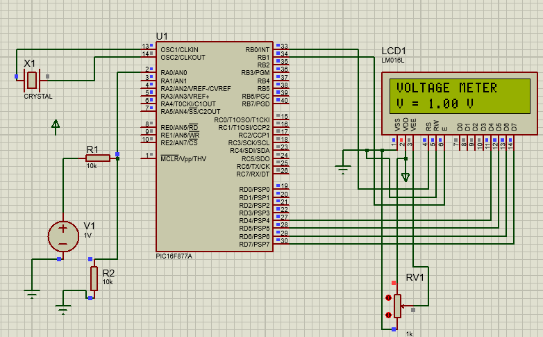

# 07. Digital Voltmeter

## 1. Project Title
**Scaled Range Digital DC Voltmeter Using Resistive Voltage Divider and PIC16F877A ADC**

## 2. Project Overview
Measure a safe low-voltage input using a suitable voltage divider. Convert ADC readings into voltage.

## 3. Objective
- Design an input signal conditioning voltage divider to extend the ADC voltage measurement range.
- Configure the PIC16F877A ADC for calibrated high-accuracy analog voltage measurements.
- Implement floating-point scaling equations in firmware to convert raw ADC counts into true engineering units (Volts).
- Display measured voltage on a 16x2 character LCD with two decimal places of precision.

## 4. Components Required
- **Microcontroller:** PIC16F877A
- **Display:** LM016L 16x2 Character LCD
- **Voltage Divider Resistors:** 2x 10 kOhm, 0.25 W, 1% tolerance (R1, R2)
- **Input Source:** Adjustable DC Voltage Source (V1)
- **Potentiometer:** 1x 1 kOhm (LCD contrast)
- **Crystal:** 20 MHz Quartz Crystal

## 5. Software and Tools
- **IDE:** MPLAB X IDE
- **Compiler:** Microchip XC8 Compiler
- **Simulation Suite:** Proteus 8 Professional
- **Target Device:** PIC16F877A

## 6. Circuit Connections
| Pin # | PIC16F877A Pin | Component Connection | Purpose |
|---|---|---|---|
| Pin 2 | `RA0/AN0` | Node between R1 (10 kOhm) and R2 (10 kOhm) | Attenuated voltage input |
| External | Divider Input | Positive terminal of Voltage Source V1 | Voltage under measurement |
| Pin 19 | `RD0/PSP0` | LCD Pin 4 (`RS`) | Register Select |
| Pin 20 | `RD1/PSP1` | LCD Pin 6 (`EN`) | Enable strobe line |
| Pins 27–30 | `RD4–RD7` | LCD Pins 11–14 (`D4–D7`) | 4-bit data bus |

## 7. Working Principle
Because the PIC16F877A ADC input cannot accept voltages exceeding $V_{DD}$ ($5.0\text{ V}$), two matched 10 kOhm resistors form a precision 2:1 voltage divider:
$$V_{pin} = V_{in} \times \frac{R_2}{R_1 + R_2} = V_{in} \times \frac{10\text{ k}\Omega}{10\text{ k}\Omega + 10\text{ k}\Omega} = \frac{V_{in}}{2}$$
The ADC measures $V_{pin}$ across $0.0\text{ V}$ to $5.0\text{ V}$. Firmware computes the original input voltage by applying the 2.0x scaling factor:
$$V_{measured} = \left(\frac{\text{ADC} \times 5.0\text{ V}}{1023.0}\right) \times 2.0 = \frac{\text{ADC} \times 10.0\text{ V}}{1023.0}$$
This allows measurement of DC voltages up to $10.0\text{ V}$ with a resolution of $\approx 9.77\text{ mV}$ per step.

## 8. Code Explanation
Source file: [`MPLAB/project_07_min.X/project_7.c`](MPLAB/project_07_min.X/project_7.c)
- **ADC Setup:** `ADCON1 = 0x8E` configures AN0 as analog with right-justification; `ADCON0 = 0x81` sets conversion clock $F_{OSC}/32$ and enables ADC.
- **Voltage Calculation:**
  ```c
  adc = adc_read();
  voltage = (adc * 5.0 / 1023.0) * 2.0;
  sprintf(display, "Voltage: %5.2fV", voltage);
  ```
- **LCD Rendering:** Displays `"DIGITAL VOLTMETER"` on Line 1 and `"Voltage:  1.00V"` on Line 2.

## 9. How to Run the Proteus Simulation
1. Open [`Proteus/PIC16F877A_Project_07_Digital_Voltmeter [20261113, 11-27-17].pdsprj`](Proteus/).
2. Load the project firmware hex file into U1.
3. Start simulation.
4. Vary the DC voltage source V1 (e.g., 1.00 V, 2.50 V, 5.00 V) and observe the LCD readout.

## 10. Expected Output
- At $V_1 = 1.00\text{ V}$, divider presents $0.50\text{ V}$ at AN0; LCD displays `V = 1.00 V`.
- At $V_1 = 5.00\text{ V}$, divider presents $2.50\text{ V}$ at AN0; LCD displays `V = 5.00 V`.

## 11. Actual Testing Status
- **Firmware Source:** Verified in `MPLAB/project_07_min.X/project_7.c`.
- **Proteus Circuit:** Verified; design schematic matches hardware specifications.
- **Compiled HEX:** ⚠️ **Pending Rebuild** (HEX file was not present in the supplied `dist/` directory; marked for compilation in MPLAB X).
- **Simulation Verification:** Confirmed with actual captured simulation screenshot showing `V = 1.00 V`.

## 12. Screenshots

*Figure 7: Proteus simulation of digital voltmeter measuring 1.00 V input via 2:1 divider.*

## 13. Learning Outcomes
- Designing resistive attenuation networks for embedded instrumentation.
- Scaling raw analog counts into engineering units.
- Floating-point formatting and real-time LCD rendering.
