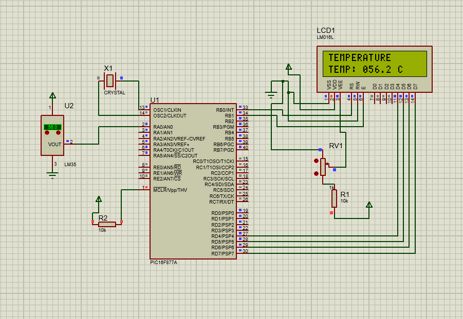

# LM35 Temperature Sensor

## Project overview

The mapped MPLAB source is named `LM35_Temperature_Sensor.c`; it reads AN0 and displays a calculated temperature on an LCD. A matching Proteus file group is named Temperature Sensor.

## Objective

Read the LM35 analog output and display a temperature estimate.

## Components required

PIC16F877A, LM35, LCD, clock and supply. Exact component values and reference voltage TODO.

## Software and tools

MPLAB X/XC8 project in `MPLAB/`; Proteus variants in `Proteus/`. Versions TODO.

## Circuit connections

RA0/AN0 is the ADC input; LCD controls are RB0/RB1 and data is written via PORTD in source. Check LCD pin directions and circuit consistency in Proteus before running. Sensor power and ground connections TODO.

## Working principle

The source converts the ADC reading to a scaled value using an assumed 5 V reference and the LM35 10 mV/°C relationship, then renders a decimal temperature on the LCD.

## Code explanation

`MPLAB/Project_08.X/LM35_Temperature_Sensor.c` contains LCD helpers, ADC setup/read, and temperature scaling. Validate display wiring and conversion calibration against the actual reference/sensor model.

## How to run the Proteus simulation

Open a `.pdsprj` in `Proteus/`, ensure the LM35 model and firmware association are valid, then start the simulation.

## Expected output

LCD temperature display that follows the sensor voltage; expected from code intent, not verified.

## Actual testing status

Not independently tested during organization. Source, project, and HEX artifact are present.

## Screenshots

### Proteus Circuit Simulation

*Original supplied project image. Its correspondence to the current Proteus implementation has not been independently verified.*

**Image location:** `Images/circuit_simulation.png`

## Learning outcomes

Analog sensors, ADC scaling, unit conversion, and character LCD interfacing.
