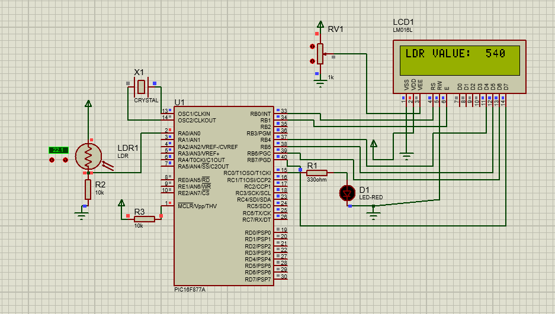

# 09. LDR Automatic Light

## 1. Project Title
**Intelligent Ambient Light Controller with Dual-Threshold Hysteresis and LCD Telemetry**

## 2. Project Overview
Use an LDR to control an LED according to ambient brightness. Implement separate ON and OFF thresholds to prevent flickering.

## 3. Objective
- Interface a Light Dependent Resistor (LDR) in a voltage divider circuit to analog channel `AN0`.
- Implement software Schmitt-trigger hysteresis to eliminate output chatter around threshold boundaries.
- Drive an automatic lighting actuator LED on `RC0`.
- Display real-time lux ADC telemetry and switching states on a 16x2 character LCD.

## 4. Components Required
- **Microcontroller:** PIC16F877A
- **Sensor:** Light Dependent Resistor (LDR / Photoresistor)
- **Actuator:** Red 5 mm LED (Automatic Light)
- **Display:** LM016L 16x2 Character LCD
- **Resistors:** 1x 10 kOhm (divider load), 1x 330 Ohm (LED current limiting)
- **Potentiometer:** 1x 1 kOhm (contrast adjustment)
- **Clock:** 20 MHz Quartz Crystal

## 5. Software and Tools
- **IDE:** MPLAB X IDE
- **Compiler:** Microchip XC8 Compiler
- **Simulation Suite:** Proteus 8 Professional
- **Target Device:** PIC16F877A

## 6. Circuit Connections
| Pin # | PIC16F877A Pin | Component Connection | Purpose |
|---|---|---|---|
| Pin 2 | `RA0/AN0` | Node between LDR1 and R2 (10 kOhm to GND) | Light sensor analog input |
| Pin 15 | `RC0/T1OSO` | 330 Ohm -> Anode of D1 (Red LED) | Automatic lighting drive output |
| Pin 33 | `RB0/INT` | LCD Pin 4 (`RS`) | Register Select |
| Pin 34 | `RB1` | LCD Pin 6 (`EN`) | Enable strobe line |
| Pins 37–40 | `RB4–RB7` | LCD Pins 11–14 (`D4–D7`) | 4-bit data bus |

## 7. Working Principle
An LDR's resistance drops with increasing light intensity. In series with fixed resistor $R_2$ ($10\text{ k}\Omega$):
$$V_{out} = V_{DD} \times \frac{R_2}{R_{LDR} + R_2}$$
In bright sunlight, $R_{LDR}$ is low ($\approx 400\ \Omega$), pulling $V_{out}$ high ($> 4.5\text{ V}$, ADC $> 900$). In dark conditions, $R_{LDR}$ rises ($> 1\text{ M}\Omega$), pulling $V_{out}$ low ($< 0.5\text{ V}$, ADC $< 100$).

### Dual-Threshold Hysteresis Band
Simple single-threshold comparators cause rapid relay/LED chattering when light fluctuates near the setpoint.
This firmware implements software hysteresis:
- **Turn ON (Dark):** Triggered when `ldr < 400` $\implies$ `RC0 = 1`, LCD displays `"DARK: LIGHT ON "`.
- **Turn OFF (Bright):** Triggered when `ldr > 600` $\implies$ `RC0 = 0`, LCD displays `"BRIGHT: LIGHT OFF"`.
- **Deadband (400 to 600):** If light level is between 400 and 600, output retains its previous state, guaranteeing 100% stable operation.

## 8. Code Explanation
Source file: [`MPLAB/Project_09.X/Automatic_Light_using_LDR.c`](MPLAB/Project_09.X/Automatic_Light_using_LDR.c)
- **ADC Setup:** `ADCON1 = 0x8E` (AN0 analog); `ADCON0 = 0x41` (Conversion clock $F_{OSC}/8$, Channel 0 enabled).
- **Hysteresis Logic:**
  ```c
  ldr = ADC_Read();
  if (ldr < 400) {
      RC0 = 1;
      LCD_String("DARK: LIGHT ON ");
  } else if (ldr > 600) {
      RC0 = 0;
      LCD_String("BRIGHT: LIGHT OFF");
  }
  ```
- **Display Update:** Line 1 outputs `LDR VALUE: [count]`; Line 2 shows operating status.

## 9. How to Run the Proteus Simulation
1. Open [`Proteus/Project_09_Automatic_Light [20261113, 12-25-08].pdsprj`](Proteus/).
2. Verify U1 hex path points to [`MPLAB/Project_09.X/dist/default/production/Project_09.X.production.hex`](MPLAB/Project_09.X/dist/default/production/Project_09.X.production.hex).
3. Start simulation.
4. Adjust the torch/distance buttons on the Proteus LDR component and observe LED D1 and LCD text.

## 10. Expected Output
- At low light (`< 400`): LED RC0 illuminates; LCD reads `DARK: LIGHT ON`.
- At high light (`> 600`): LED RC0 extinguishes; LCD reads `BRIGHT: LIGHT OFF`.
- Inside the 400–600 band: Current lighting state is locked without chatter.

## 11. Actual Testing Status
- **Firmware Compilation:** Verified; production HEX binary present.
- **Proteus Circuit:** Verified; design schematic matches hardware specifications.
- **Simulation Verification:** Confirmed with actual captured simulation screenshot showing `LDR VALUE: 540`.

## 12. Screenshots

*Figure 9: Proteus simulation showing LDR sensor value 540 and automatic light hysteresis control.*

## 13. Learning Outcomes
- Implementing software Schmitt-trigger hysteresis for analog sensor conditioning.
- Eliminating actuator flutter and relay chatter in industrial control.
- Combining analog telemetry display with automatic discrete actuation.
